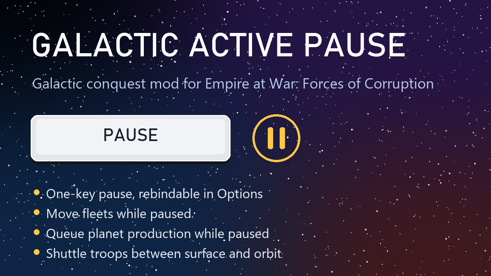

# Galactic Active Pause — Star Wars: Empire at War: Forces of Corruption



Press **Pause** on the galactic map to pause, and press it again to resume. While you have the game paused, you can still give orders: move fleets, queue planet production, and move troops between the surface and orbit. Nothing moves or builds until you unpause.

- **Rebindable in the game:** *Options > Keyboard > Interface > Pause/Play*. The default is the Pause key, because Space is the game's Battle Cam key.
- The "Game Paused" banner appears instantly instead of sliding in.
- The on-screen Pause/Play button stays in sync.

By **nanduskaiser**. Released under the MIT License. This mod was previously called *Space Bar Pause*.

Supported build: the Steam 64-bit release, `corruption\StarWarsG.exe` (PE timestamp `0x67002393`, 2024 patch). It works alongside data mods such as AotR and Thrawn's Revenge, including Workshop mods.

## Install

1. Get the mod in one of these ways:
   - Download `GalacticActivePause-vX.Y.Z.zip` from [Releases](https://github.com/nandusmasta/swfoc-galactic-active-pause/releases) and extract it.
   - Download it from [ModDB](https://www.moddb.com/mods/space-bar-pause-orders-while-paused).
   - Subscribe on the [Steam Workshop](https://steamcommunity.com/sharedfiles/filedetails/?id=3819157144). The files then appear in `steamapps\workshop\content\32470\3819157144\`.
2. Double-click **`Install.bat`**. It finds the game through your Steam libraries. If it can't, it asks for the `corruption` folder.
3. Start Forces of Corruption normally.

To install by hand, copy `winmm.dll` into `...\steamapps\common\Star Wars Empire at War\corruption\`.

To uninstall, run **`Uninstall.bat`**. It removes `winmm.dll` and the generated keyboard-options layout (`corruption\Data\Resources\GUIDialog\GUIDialogs.rc`).

When the game starts, the mod writes `corruption\SpaceBarPause.log`. A working install logs this line:

```
Galactic Active Pause v1.1.0 active: Pause/Play key in Options > Keyboard > Interface.
```

If a game update changes the executable, the log says `Unsupported StarWarsG.exe build`. In that case the mod patches nothing and the game runs normally.

### Settings (optional)

Settings go in `SpaceBarPause.ini`, in the `corruption` folder next to the DLL. A template ships as `SpaceBarPause.ini.example`.

```ini
[SpaceBarPause]
AllowOrdersWhilePaused=1  ; 0 = vanilla: orders are refused while paused
```

## Behaviour

- It only works in galactic mode, using the galactic command-bar layout. Tactical battles are unchanged.
- It does nothing while a dialog is open or while the game is blocking input.
- If the game refuses to pause, the key falls through to normal handling. This happens in multiplayer and while a battle is pending. Story scripts can also hold the system pause.
- The key toggles between Paused and Play. If you were fast-forwarding, pausing and then pressing the key again resumes at normal speed.
- **Orders while paused.** While you have paused the game yourself, with the key or the button, you can still move fleets, move units between the surface and orbit, and select. The orders take effect, but nothing moves until you unpause, because galactic time, production and the AI stay frozen. Orders are still refused when something else holds the pause, such as a pending battle or a story script.
- If another mod ships its own `GUIDialogs.rc`, the Pause/Play row is missing from that mod's options screen. The key still works with its saved or default binding.

## How it works

`winmm.dll` is a proxy DLL. Every export is forwarded to the real `System32\winmm.dll`; `src/winmm_proxy.c` and `src/winmm.def` are generated by `tools/gen_proxy.py`. `StarWarsG.exe` imports `WINMM.dll`, and Windows loads it from the game folder first.

When the DLL loads into `StarWarsG.exe`, it first checks the exe's exact build (timestamp and image size). It then checks the original bytes at every site it patches.

- **The key:** it adds key slot 153 ("Pause/Play", default `VK_PAUSE`) to the game's key-binding table. The hotkey dispatcher detour then calls the same functions as the `b_play_pause` button whenever the game's own lookup maps a key to that slot.
- **The options row:** at startup it writes a loose `Data\Resources\GUIDialog\GUIDialogs.rc`, generated from `Patch2.meg` with a Pause/Play row added to the Interface tab. The game reads loose files ahead of its archives. The mod never overwrites a copy it didn't create.

### Reverse-engineered addresses (RVAs, StarWarsG.exe)

| RVA | What |
|---|---|
| `0x063f00` | `char Hotkey_Dispatch(int vk)`: maps a key to a key-binding slot and runs the command through a jump table. Slot 78 is Battle Cam (Space). |
| `0xa7c3a8` / `0xa7c3c0` | Key-binding table (`{key, modifier}[count]` at `+8`, count at `+0x10`) and the options dialog's working copy. Set_Defaults `0x211940`, Set `0x212520`, Lookup `0x2127f0`. The mod raises the slot count from 153 to 154 (`0x2119a9`, `0x2119bd`, `0x2119cf`, `0x211a07`, `0x211a0c`, and the registry loader `0x212e81`). |
| `0x0aefa0` / `0x0aeaa0` / `0x0af410` | Keyboard options, Interface tab: refresh, event handler (registered at `0x0ae546`), bind with duplicate warning. Each tab names slots from its own 64-byte label table. The mod points all ten references at one copy that also names slot 153. |
| `0x1c3c40` / `0xa78510` | `DialogManager::Is_Active` and its singleton |
| `0xb155c4` | Input-blocked byte checked by the dispatcher |
| `0xb15418` | Current `GameMode*`. vfunc `+0xE0` gives the mode type: 0 galactic, 1/2 tactical. |
| `0xb1540c` | Galactic pause count (`GameModeManager+0x2c`). Pause/Play add or remove one; pending battles and scripts add their own. The galactic object update (`0x1402be640`) freezes time while it is > 0. Galactic pause also clears `TheAIClass` "AI enabled" byte 0 through `0x1404d9fa0`. |
| `0x3c4495`, `0x5af297`, `0x3acc12`, `0x4b2366`, `0x3beaf` | `cmp [pause count],0` order checks in MoveThroughObjectsEvent, FleetManagementEvent, SelectEvent, `GalacticModeClass::Is_Locked` (vtable `+0x48`) and the galactic order input. For orders while paused, the mod redirects these to a stub that subtracts the manual pause. |
| `0xb27f60` | `CommandBar` singleton. `+0x2968` is the speed state (0 paused, 1 normal, 2 fast). `+0x211c` is the layout (1 galactic). |
| `0x31f870` / `0x31fcd0` | `CommandBar::Pause()` / `CommandBar::Play()`, the `b_play_pause` handlers |
| `0xa174e0` | Command-bar component table (0x48-byte entries: name, component*, handlers at `+0x18`/`+0x38`). `b_play_pause` is id `0x26a`. |
| component `0x2ab` | `pause_shell`, the "Game Paused" banner. Its model (`+0xc8`) plays a one-shot slide-in. The mod backdates the model's last animation update (`+0x148`) so the slide-in finishes on the next frame. |
| vfunc `+0x1D0` | Button `Set_State(int)`: 3 is toggled on, 1 is normal |

Key bindings are saved in `HKCU\Software\Petroglyph\StarWars FOC\Profiles\Profile0\Player` as `KeySettingKeycode<N>` / `KeySettingModifier<N>`.

## Tools

- `tools/meg.py`: list and extract `.meg` archives.
- `tools/dat.py`: dump `mastertextfile_*.dat`.
- `tools/xref.py`: find string addresses and the code that references them in an `objdump -d -M intel` listing.
- `tools/dis.sh`: print a listing from a given address.
- `tools/gen_proxy.py`: generate the winmm forwarding stubs.
- `tools/vtable.py`, `tools/whose_vtable.py`: find MSVC vtables through RTTI, and work out which class owns a vtable slot.
- `tools/make_preview.py`, `tools/make_feature_images.py`: render the store art in `package/art/`.
- `tools/package.py`: build the release zip and the Steam Workshop item into `dist/`.
- `tools/upload_workshop.ps1`: upload `dist/workshop` with SteamCMD.
- `test/test_offline.c`: applies every patch to the real `StarWarsG.exe` mapped as an image, and checks the generated dialog layout. Build it with `gcc -o t.exe test/test_offline.c src/winmm_proxy.c`, then run `t.exe <corruption dir> <scratch dir containing Data\Patch2.meg>`.

## Build

Needs MinGW-w64 gcc (x86_64):

```sh
sh build.sh              # build/winmm.dll
python tools/package.py  # dist/GalacticActivePause-v<version>.zip and dist/workshop/
```

To cut a new version, bump `MOD_VERSION` in `src/spacebar_pause.c` and the version in `package/ReadMe.txt`.
